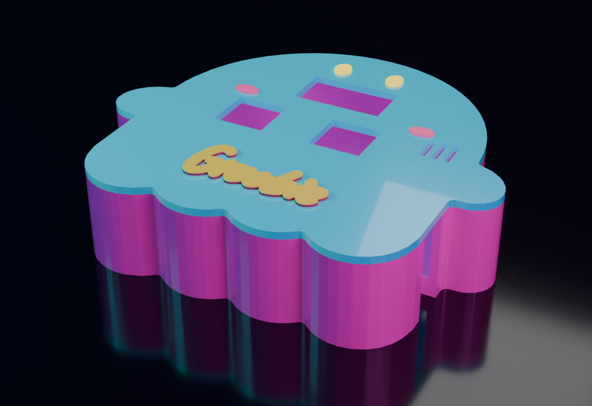
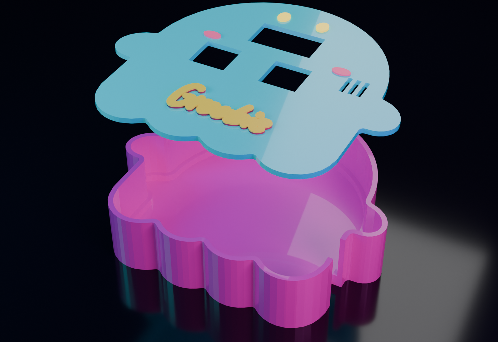

Groobie!

Your desktop pet that loves dancing 😎

# Who's Groobie?

### Groobie is your little friend that loves to dance. (and also encourages you to).

A tiny ghost-shaped desk pet on a custom ghost PCB around a Seeed XIAO ESP32-C3, with a 0.96in OLED, an MPU6050 motion sensor, a DHT11 temperature/humidity sensor and two MX-style switches, in a 3D-printed case. He also reminds you to get up and move.

# What does he look like?

## 3D printed case

Groobie lives in a two-part 3D printed case (tray and lid) with the PCB sitting on a ledge inside. The lid has cutouts for the OLED and both switches, vents for the DHT11, and a colored logo, eyes and blush on top. The editable CAD is `groobie_case.step`.

## How to use Groobie

Groobie lives on the OLED. He wanders back and forth along the bottom of the screen and
his joy, energy and fullness stats are saved, so he remembers them after power-off.

### Controls

| Control | What it does |
|---|---|
| **Button 1** (wired to D2) | Opens the Menu. Press it again in the menu to confirm your choice. |
| **Tilt Groobie** (while the menu is open) | The MPU6050 works like an air mouse. A ball on screen follows your tilt, and tilting toward a side highlights that action. |
| **Button 2** (wired to D3) | Shows or hides the stats screen (joy, energy, fullness, temperature, humidity). It never changes Groobie, it only lets you peek. |
| **Shake Groobie** (outside the menu) | Cheers him up (joy +5, energy -2, fullness -1) and wakes him if he is napping. |

### The Menu

Press Button 1, hold Groobie however is comfortable (the tilt is calibrated to how you hold
him at that moment), tilt toward an action, then press Button 1 again to confirm.
If the ball is still in the middle, nothing is selected and the menu stays open.

| Direction | Action | What happens |
|---|---|---|
| Top | NAP | Groobie sleeps for 48 seconds with floating Zs. Restores energy. |
| Right | DANCE | Groobie sways and hops three loops with hearts and music notes. Big joy boost, costs energy. |
| Bottom | SNACK | Groobie wiggles and jumps. Raises fullness. |
| Left | PET | Groobie jumps and sends up hearts. Raises joy. |

Stats are 0 to 100 and only change when you pick an action or shake him. Nothing drains
while he sits on your desk.

### Move reminder

Groobie's real job: if you have not touched or shaken him for **30 minutes**, he starts
bouncing on the spot and shows a **MOVE!** speech bubble above his head. That is your cue
to stand up, stretch or walk around. To say "ok, I moved", press either button or shake
him, and the reminder resets for another 30 minutes. He does not nag while napping.

To change the interval, edit `MOVE_REMINDER_MINUTES` in `Groobie.ino` (set it to 0 to turn
the reminder off).

## Bill of materials

Full list in [`bom.csv`](bom.csv).

| Ref | Part | Qty | Unit (USD) | Total (USD) | Vendor |
|---|---|---|---|---|---|
| U2 | Seeed Studio XIAO ESP32-C3 | 1 | 15.17 | 15.17 | AliExpress (FMchip AE Store) |
| J2 | MPU6050 GY-521 accel/gyro breakout | 1 | 3.86 | 3.86 | AliExpress (Nextronics Store) |
| - | MX keycaps, 10-pack blank 1U (2 used, optional) | 1 | 3.07 | 3.07 | AliExpress (SZElectronic Store) |
| SW1, SW2 | Outemu 3-pin MX switch, red, 10-pack (2 used) | 1 | 2.38 | 2.38 | AliExpress (SZ suhv Store) |
| U1 | DHT11 temperature and humidity sensor | 1 | 1.14 | 1.14 | AliExpress (Simple Robot Store) |
| R1 | 10k resistor, 1/4W 1%, 100-pack (1 used) | 1 | 1.10 | 1.10 | AliExpress (TriArk Electronic Components Store) |
| J1 | 0.96in 128x64 SSD1306 I2C OLED | 1 | 0.99 | 0.99 | AliExpress (DIY-Victor Store) |
| - | Groobie custom ghost PCB (`groobie.kicad_pcb`, gerbers in `gerbers/`) | 1 | TBD | TBD | PCB fab |
| - | 3D printed case: tray, lid, logo and face inlays | 1 | TBD | TBD | Self-printed |
| | **Parts subtotal (electronics only, before tax and shipping)** | | | **27.71** | |

## Wiring

| Signal | XIAO pin | ESP32-C3 GPIO |
|---|---|---|
| OLED + MPU6050 SDA | D5 | 7 |
| OLED + MPU6050 SCL | D4 | 6 |
| DHT11 data | D1 | 3 |
| Button 1 (menu) | D2 | 4 |
| Button 2 (stats) | D3 | 5 |

The OLED is at I2C address 0x3C and the MPU6050 at 0x68.

## Building one

1. Order the PCB from the gerbers in `gerbers/` and the parts from the BOM.
2. Solder the XIAO, OLED, MPU6050, DHT11, resistor and the two switches.
3. Open `Groobie.ino` in the Arduino IDE, install the Adafruit GFX, Adafruit SSD1306,
   Adafruit MPU6050 and DHT sensor libraries, pick the XIAO ESP32-C3 board and upload.
4. Print the case from `groobie_case.step` (tray, lid, then the colored logo, eye and blush pieces),
   and fit the colored pieces onto the lid.

## Files

| Path | What it is |
|---|---|
| `groobie.kicad_sch` | Editable KiCad schematic |
| `groobie.kicad_pcb`, `groobie.kicad_pro` | Editable KiCad PCB and project |
| `gerbers/` | Fabrication files |
| `Groobie.ino` | Firmware (Arduino, one file) |
| `bom.csv` | Bill of materials |
| `groobie_case.step` | Editable CAD of the full case with PCB and parts |
| `renders/` | 3D renders of the case |

## Are you using AI?

A little, only when I get stuck.
